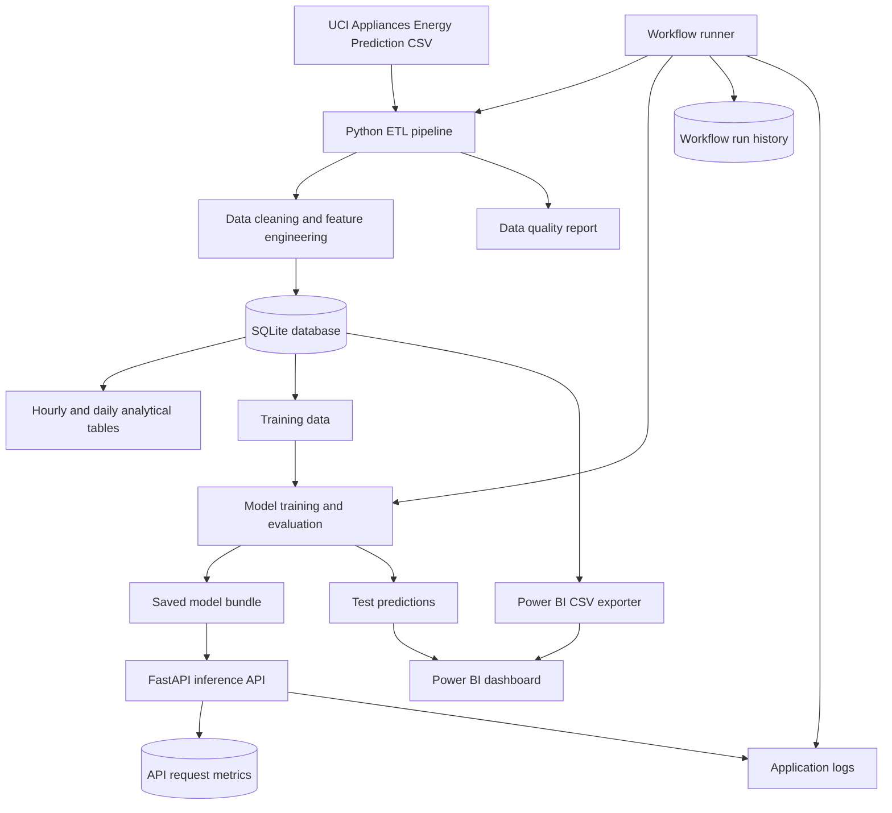

# Energy Consumption Analytics & Machine Learning

An end-to-end data engineering and machine learning project that processes household energy data, stores analytical datasets, trains a regression model to forecast short-term appliance consumption, exposes predictions through a REST API, monitors executions, and presents results in Power BI.

> **Project status:** Local end-to-end implementation completed. An AWS migration is proposed as a future extension; the current implementation does not use AWS services.

## Contents

- [Project overview](#project-overview)
- [Dataset](#dataset)
- [Architecture](#architecture)
- [Technology stack](#technology-stack)
- [Data engineering workflow](#data-engineering-workflow)
- [Machine learning](#machine-learning)
- [Inference API](#inference-api)
- [Automation and monitoring](#automation-and-monitoring)
- [Power BI dashboard](#power-bi-dashboard)
- [Project structure](#project-structure)
- [Run locally](#run-locally)
- [Results](#results)
- [Limitations and future work](#limitations-and-future-work)
- [Future AWS architecture](#future-aws-architecture)
- [Dataset reference](#dataset-reference)

## Project overview

The goal is to build a reproducible local analytics and ML workflow around household energy consumption data. The project covers the main stages of a data product lifecycle:

1. Ingest and transform raw data with Python and Pandas.
2. Store detailed observations and hourly/daily analytical tables in SQLite.
3. Train and evaluate regression models using a chronological split.
4. Serve predictions through a FastAPI application.
5. Orchestrate the pipeline and model training with a single workflow command.
6. Record application/workflow metrics and logs.
7. Export datasets and visualize energy trends and model performance in Power BI.

The project is designed as a portfolio and learning implementation. It is not a real-time production energy platform and does not currently run on AWS.

## Dataset

The project uses the **Appliances Energy Prediction** dataset from the UCI Machine Learning Repository.

- 19,735 observations.
- Measurements recorded at 10-minute intervals over approximately 4.5 months.
- Appliance and lighting energy consumption, indoor temperature/humidity measurements, outdoor weather variables, and timestamps.
- Regression use case: predict appliance consumption for the next 10-minute interval.

The original dataset includes two random variables (`rv1` and `rv2`) and a timestamp. The project applies its own cleaning, temporal feature engineering, and aggregation steps before model training.

Place the downloaded `energydata_complete.csv` file in `data/` before running the pipeline. The raw dataset and generated local database/exports are treated as local data assets and should not be committed unless the repository intentionally adopts a data-versioning strategy.

## Architecture

### Current local architecture



SQLite is the local persistence layer. Power BI receives CSV exports generated from the SQLite tables and the model's test predictions.

## Technology stack

| Area | Technologies |
|---|---|
| Programming | Python |
| Data processing | Pandas, NumPy |
| Storage | SQLite |
| Machine learning | Scikit-learn |
| Model persistence | Joblib |
| API | FastAPI, Uvicorn |
| Monitoring and logging | Python logging, SQLite |
| Business intelligence | Power BI Desktop |
| Version control | Git, GitHub |

## Data engineering workflow

The ETL pipeline (`src/data_pipeline.py`) loads the source CSV, performs data preparation and temporal feature engineering, creates analytical aggregations, and produces a data quality report.

The storage layer (`src/storage.py`) persists the processed datasets in `data/energy_analytics.db`.

The main analytical tables are:

| Table | Purpose | Rows in the current local run |
|---|---|---:|
| `energy_observations` | Processed observation-level data | 19,735 |
| `energy_hourly` | Hourly aggregations | 3,290 |
| `energy_daily` | Daily aggregations | 138 |

Operational tables are also used to record pipeline runs, workflow runs, and API requests (`pipeline_runs`, `workflow_runs`, and `api_requests`).

The hourly and daily tables contain energy totals and average environmental measurements. They are kept at separate granularities to avoid mixing hourly and daily values in the same calculation.

## Machine learning

### Objective

Predict appliance energy consumption (`Appliances`) for the **next 10-minute interval** using information available at the current observation. The current appliance consumption is included among the input features.

### Training setup

- Valid prediction pairs: 19,734 (one row is excluded because the next-step target cannot be constructed for the final observation).
- Input features: 32 engineered/model features.
- Chronological split: 70% training, 15% validation, 15% test.
- Training rows: 13,813.
- Validation rows: 2,960.
- Test rows: 2,961.
- Median `DummyRegressor` used as a baseline.
- Random Forest and HistGradientBoosting evaluated as candidate regressors.
- Missing-value imputation is included in the modelling pipeline.
- The model is selected using validation RMSE, then refitted on training plus validation data and evaluated once on the held-out test set.

### Evaluation results

Validation metrics:

| Model | MAE (Wh) | RMSE (Wh) | R² |
|---|---:|---:|---:|
| HistGradientBoosting | 29.2120 | 62.3524 | 0.5430 |
| Random Forest | 42.9428 | 78.0452 | 0.2841 |
| Median baseline | 42.6047 | 98.1076 | -0.1313 |

Final test metrics for HistGradientBoosting:

| Metric | Test result |
|---|---:|
| MAE | 32.0710 Wh |
| RMSE | 63.1409 Wh |
| R² | 0.5172 |

These results are specific to the supplied dataset and chronological split. They should not be interpreted as a guarantee of performance on other buildings, time periods, or live data.

Model artefacts and evaluation outputs are written to:

- `models/best_energy_model.joblib`
- `outputs/model_evaluation.json`
- `outputs/test_predictions.csv`

## Inference API

The FastAPI application (`src/api.py`) loads the saved model bundle and provides the following endpoints:

| Method | Endpoint | Purpose |
|---|---|---|
| GET | `/health` | Health check |
| GET | `/features` | Returns the expected model feature schema |
| POST | `/predict` | Returns an appliance-consumption prediction |
| GET | `/metrics` | Returns basic API request metrics |

The prediction endpoint expects the complete set of 32 features. Use `GET /features` to retrieve the required names and ordering rather than manually guessing the payload schema.

Run the API from the project root:

```cmd
python -m uvicorn api:app --app-dir src --reload --host 127.0.0.1 --port 8000
```

Open the interactive API documentation at:

`http://127.0.0.1:8000/docs`

The API is configured for local access (`127.0.0.1`). It has not been hardened or deployed as a publicly accessible production service.

## Automation and monitoring

`src/run_workflow.py` runs the ETL pipeline and model-training script sequentially using the active Python interpreter. It records execution status and duration in the `workflow_runs` SQLite table.

Logging and monitoring components:

- `src/monitoring.py`: shared application logger with console and rotating file output.
- `logs/energy_analytics.log`: local application log file.
- `workflow_runs`: workflow execution history.
- `pipeline_runs`: pipeline execution history.
- `api_requests`: API request status and response-time records.
- `src/monitoring_report.py`: prints a summary of workflow, pipeline, and API monitoring information.

Run the monitoring report with:

```cmd
python src/monitoring_report.py
```

The workflow is manually triggered by one command; it is not currently scheduled to run automatically.

## Power BI dashboard

The exporter (`src/export_power_bi.py`) creates a set of CSV files in `data/power_bi/`:

- `energy_observations.csv`
- `energy_hourly.csv`
- `energy_daily.csv`
- `test_predictions.csv`

The Power BI report contains three pages:

1. **Energy Overview** — total and average consumption, daily appliance consumption, daily lighting consumption, and hourly consumption.
2. **Environmental Analysis** — indoor/outdoor temperature and humidity trends, plus a temperature-versus-consumption scatter plot.
3. **ML Predictions** — MAE, RMSE, R², actual-versus-predicted consumption, prediction scatter plot, and absolute-error trend.

The Power BI file is intended to be saved as `reports/energy_analytics.pbix`.

After refreshing the local pipeline and model, regenerate the CSV files:

```cmd
python src/export_power_bi.py
```

Then open the PBIX file and select **Refresh**. The report uses local file imports; it is not connected to a cloud data platform.

## Project structure

```text
energy-consumption-analytics-ml/
├── data/
│   ├── energydata_complete.csv          # downloaded source dataset (local)
│   ├── energy_analytics.db              # generated SQLite database (local)
│   └── power_bi/                        # generated CSV exports (local)
├── docs/
│   └── AWS_MIGRATION_PROPOSAL.md        # proposed future AWS architecture
├── logs/                                # generated application logs
├── models/
│   └── best_energy_model.joblib         # trained model artefact
├── outputs/
│   ├── model_evaluation.json
│   └── test_predictions.csv
├── reports/
│   └── energy_analytics.pbix            # Power BI report
├── src/
│   ├── api.py
│   ├── data_pipeline.py
│   ├── export_power_bi.py
│   ├── monitoring.py
│   ├── monitoring_report.py
│   ├── run_workflow.py
│   ├── storage.py
│   ├── test_api.py
│   └── train_model.py
└── README.md
```

Generated files may be excluded by `.gitignore` according to repository policy. The structure above describes the intended project layout; optional local artefacts may not be tracked in Git.

## Run locally

The commands below use Windows CMD syntax.

### 1. Clone the repository and create the environment

```cmd
git clone <YOUR_GITHUB_REPOSITORY_URL>
cd <REPOSITORY_FOLDER>
python -m venv .venv
.venv\Scripts\activate.bat
```

Install the project dependencies in the virtual environment. At minimum, the current workflow uses the packages below; if the repository contains a maintained `requirements.txt`, prefer installing from that file.

```cmd
python -m pip install pandas numpy scikit-learn joblib fastapi uvicorn
```

### 2. Add the source dataset

Download the dataset from the UCI page linked below and place `energydata_complete.csv` in the `data/` directory.

### 3. Run the complete local workflow

```cmd
python src\run_workflow.py
```

This runs data processing and model training in sequence. It does not start the API or refresh Power BI automatically.

### 4. Export data for Power BI

```cmd
python src\export_power_bi.py
```

### 5. Start the API

```cmd
python -m uvicorn api:app --app-dir src --reload --host 127.0.0.1 --port 8000
```

### 6. Test the API

With the API running, open a second terminal and execute:

```cmd
python src\test_api.py
```

Use `http://127.0.0.1:8000/docs` to inspect and test the endpoints interactively.

## Limitations and future work

- The source dataset is historical and static; the project does not ingest a live smart-meter or IoT stream.
- The model is evaluated on one building dataset and one chronological hold-out period.
- The workflow is manually triggered; no recurring scheduler is configured.
- The API is a local prototype and does not include production authentication, TLS termination, or public deployment.
- Monitoring is based on local logs and SQLite records. Automated alerting and model/data-drift detection are not implemented.
- Power BI imports local CSV files. There is no cloud warehouse connection or automated cloud refresh.
- The project has not been deployed to AWS. The architecture in the AWS proposal is a design, not an implemented component.

Possible extensions include automated tests with `pytest`, Docker packaging, scheduled ingestion, data/model drift monitoring, CI/CD, and the AWS migration described in [`docs/AWS_MIGRATION_PROPOSAL.md`](docs/AWS_MIGRATION_PROPOSAL.md).

## Future AWS architecture

A proposed AWS version would use Amazon S3 as the data lake, AWS Glue Data Catalog and Amazon Athena for analytical discovery/querying, AWS Step Functions and EventBridge Scheduler for orchestration, Amazon SageMaker AI for managed model training, Amazon ECS on AWS Fargate for the existing FastAPI service, and Amazon CloudWatch for logs and metrics. Power BI could query Athena through its Amazon Athena connector.

This is a future-state proposal only. The detailed service mapping, migration stages, security controls, and cost considerations are documented in [`docs/AWS_MIGRATION_PROPOSAL.md`](docs/AWS_MIGRATION_PROPOSAL.md).

## Dataset reference

Candanedo, L. M., Feldheim, V., & Deramaix, D. (2017). *Data driven prediction models of energy use of appliances in a low-energy house*. Energy and Buildings, 140, 81–97.

- UCI Machine Learning Repository: https://archive.ics.uci.edu/dataset/374/appliancesenergyprediction
- Dataset DOI: https://doi.org/10.24432/C5VC8G
