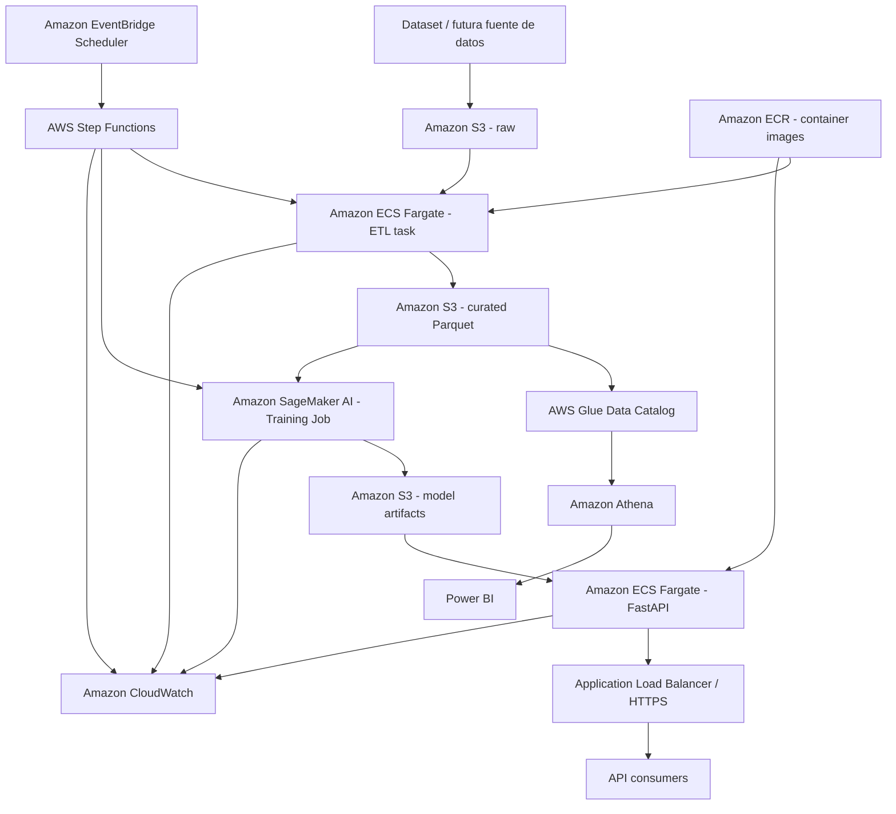
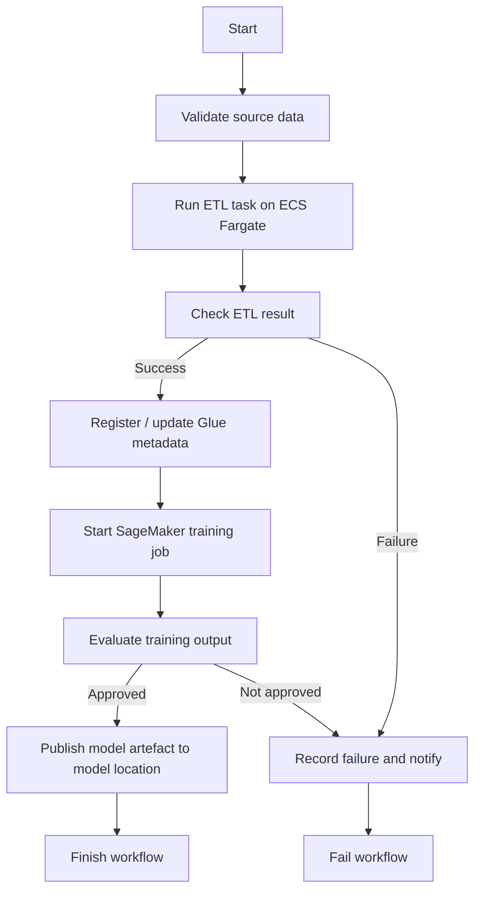

# Propuesta de migración a AWS

## 1. Objetivo y alcance

El objetivo es evolucionar la implementación local de **Energy Consumption Analytics & ML** hacia una arquitectura desplegada en AWS, manteniendo en lo posible el código Python y los componentes ya desarrollados.

La propuesta cubre:

- Almacenamiento centralizado de datos.
- Ejecución del pipeline ETL.
- Orquestación y programación de workflows.
- Entrenamiento y almacenamiento de modelos.
- Despliegue de la API de inferencia.
- Monitorización y gestión de errores.
- Consulta analítica desde Power BI.

**Estado actual:** esta arquitectura no está implementada. Es un diseño de migración y una ruta de aprendizaje. El proyecto actual funciona localmente con Python, SQLite, FastAPI y Power BI Desktop.

## 2. Arquitectura AWS propuesta

### Diagrama de alto nivel



### Flujo propuesto

1. El dataset original se deposita en un bucket de Amazon S3, en una zona `raw/`.
2. EventBridge Scheduler inicia una ejecución de Step Functions según una programación definida o bajo demanda.
3. Step Functions lanza una tarea de ETL en ECS Fargate. El contenedor ejecuta el código Python existente y escribe las tablas procesadas en S3, preferiblemente en formato Parquet.
4. AWS Glue Data Catalog registra los esquemas y ubicaciones de los datos curados. Amazon Athena permite consultarlos mediante SQL.
5. Step Functions inicia un trabajo de entrenamiento en SageMaker AI, que lee los datos desde S3 y guarda el modelo y los artefactos de evaluación en S3.
6. La API FastAPI se empaqueta en un contenedor Docker, se almacena en Amazon ECR y se ejecuta como un servicio de ECS Fargate. La API descarga/carga la versión aprobada del modelo desde S3 al iniciar o durante una actualización controlada.
7. Un Application Load Balancer proporciona un punto de entrada HTTPS a la API. El acceso debe protegerse con autenticación y reglas de red apropiadas antes de exponerlo.
8. CloudWatch centraliza logs y métricas de la ejecución ETL, los trabajos de entrenamiento, Step Functions y la API.
9. Power BI se conecta a Athena para consultar las tablas analíticas almacenadas en S3.

## 3. Correspondencia entre la solución local y AWS

| Implementación actual | Servicio AWS propuesto | Motivo |
|---|---|---|
| CSV local | Amazon S3 | Almacenamiento centralizado de datos originales y procesados |
| SQLite (`energy_observations`, `energy_hourly`, `energy_daily`) | S3 + Glue Data Catalog + Athena | Data lake y consulta analítica SQL sin mantener una base de datos local |
| `data_pipeline.py` | Contenedor en ECS Fargate | Reutilizar el pipeline Python en un entorno gestionado |
| `run_workflow.py` | AWS Step Functions | Orquestar ETL, entrenamiento y tratamiento de errores |
| Ejecución manual | EventBridge Scheduler | Programar ejecuciones recurrentes o puntuales |
| `train_model.py` | SageMaker AI Training Job | Entrenamiento gestionado y artefactos almacenados en S3 |
| `best_energy_model.joblib` | Amazon S3 (y opcionalmente SageMaker Model Registry) | Versionar y conservar modelos |
| FastAPI + Uvicorn | ECS Fargate + Application Load Balancer | Ejecutar la API en un contenedor y exponerla mediante HTTPS |
| Logs locales y tablas de métricas | Amazon CloudWatch | Centralizar logs, métricas y alarmas |
| CSV importados en Power BI | Amazon Athena connector para Power BI | Consultar datos del data lake desde Power BI |

### ¿Qué ocurre con SQLite?

SQLite es adecuado para el prototipo local y se puede conservar para desarrollo y pruebas. En la arquitectura analítica cloud propuesta no sería la capa principal de almacenamiento: los datos curados se guardarían como Parquet en S3 y se consultarían con Athena.

No añadiría Amazon RDS en la primera migración. Solo tendría sentido incorporar una base de datos relacional gestionada si apareciera una necesidad transaccional clara, por ejemplo, almacenar usuarios, estados operativos de la aplicación o registros que requieran actualizaciones transaccionales frecuentes.

## 4. Decisiones de diseño

### 4.1 Almacenamiento: S3 y Parquet

Estructura orientativa del bucket:

```text
s3://<bucket-name>/
├── raw/
│   └── appliances-energy-prediction/
│       └── energydata_complete.csv
├── curated/
│   ├── observations/
│   ├── hourly/
│   └── daily/
├── ml/
│   ├── training-data/
│   ├── model-artifacts/
│   └── evaluation/
└── predictions/
```

- `raw/` conserva el fichero original sin modificar.
- `curated/` contiene datos limpios y agregados, preferiblemente en Parquet.
- `ml/` contiene datasets preparados, modelos y resultados de evaluación.
- `predictions/` puede almacenar predicciones batch cuando exista un caso de uso que requiera conservarlas.

Parquet reduce el tamaño de los ficheros y permite consultas analíticas por columnas. Si el volumen aumenta, conviene particionar por fecha; no hace falta sobreparticionar un dataset pequeño.

### 4.2 Procesamiento: ECS Fargate frente a Lambda o Glue

La recomendación inicial es ejecutar el pipeline actual en un contenedor de ECS Fargate:

- Permite mantener el código Python y sus dependencias.
- Encaja con una tarea batch que termina al completar el procesamiento.
- Step Functions puede iniciar la tarea y esperar a que finalice.

AWS Lambda también podría servir para tareas pequeñas y acotadas, pero no sería mi primera elección para trasladar sin cambios un pipeline Python con Pandas y dependencias de ML. AWS Glue sería una alternativa si el procesamiento evoluciona hacia ETL distribuido con Spark; para el dataset actual sería una capa adicional que no aporta una ventaja clara.

### 4.3 Entrenamiento: SageMaker AI

El entrenamiento se ejecutaría bajo demanda mediante un SageMaker AI Training Job:

- Los datos de entrenamiento se leen desde S3.
- El script de entrenamiento se ejecuta en el entorno gestionado.
- El modelo y los resultados se guardan en S3.
- Step Functions espera a que el trabajo termine y gestiona éxito o error.

SageMaker Model Registry puede añadirse más adelante para registrar versiones y estados de aprobación. No es imprescindible para la primera prueba.

### 4.4 API: ECS Fargate

Para reutilizar la API FastAPI existente:

1. Crear un `Dockerfile`.
2. Construir la imagen y subirla a Amazon ECR.
3. Crear una definición de tarea y un servicio ECS Fargate.
4. Configurar un Application Load Balancer con HTTPS.
5. Configurar permisos IAM para que la tarea pueda leer el modelo de S3 y enviar logs a CloudWatch.
6. Añadir autenticación, control de acceso, validación y límites de petición antes de permitir acceso público.

Alternativa: si se quisiera delegar el hosting del modelo al servicio ML, se podría evaluar un endpoint de inferencia de SageMaker AI. Para la primera migración mantendría FastAPI en Fargate y evitaría desplegar dos servicios de inferencia simultáneamente.

### 4.5 BI: Power BI y Athena

La opción propuesta es conectar Power BI a Amazon Athena y consultar las tablas registradas en Glue Data Catalog. El conector de Amazon Athena de Power BI admite importación y DirectQuery; requiere una cuenta AWS, permisos sobre Athena y la instalación previa del controlador ODBC de Amazon Athena.

La conexión debe configurarse con credenciales y permisos limitados. Para un portfolio, el modo Import puede ser suficiente; DirectQuery solo debería elegirse si se necesita consultar el origen con más frecuencia y se ha comprobado su rendimiento.

## 5. Orquestación propuesta

Una máquina de estados de Step Functions podría implementar este flujo:



La primera versión puede mantener ETL y entrenamiento como pasos separados y lanzar el entrenamiento solo si el ETL finaliza correctamente. La promoción del modelo debe depender de las métricas y criterios de aceptación definidos; no se debe sustituir automáticamente el modelo en producción solo porque un job haya terminado.

EventBridge Scheduler puede iniciar la máquina de estados con una expresión de calendario o frecuencia. Para este dataset estático, la programación solo repetiría el procesamiento de los mismos datos. Una programación periódica tendrá sentido cuando se integre una fuente nueva o un proceso de actualización de datos.

## 6. Seguridad y operación

Controles mínimos antes de considerar la solución desplegada:

- Activar MFA en la cuenta y no utilizar credenciales root para tareas diarias.
- Aplicar IAM de mínimo privilegio a cada tarea y servicio.
- Mantener buckets S3 privados y bloquear el acceso público.
- Cifrar datos y artefactos en reposo y usar HTTPS en tránsito.
- No incluir claves, tokens o contraseñas en el código, imágenes Docker ni repositorio.
- Guardar secretos únicamente si son necesarios, por ejemplo en AWS Secrets Manager o Systems Manager Parameter Store.
- Configurar logs, métricas y alarmas de CloudWatch para fallos del workflow, errores de API y consumo de recursos.
- Definir políticas de retención para logs y datos.
- Establecer presupuestos y alertas de facturación antes de crear recursos.
- Eliminar endpoints, balanceadores, servicios y recursos de prueba cuando no se utilicen.

## 7. Costes y control del presupuesto

AWS no debe considerarse gratuito por defecto. El coste depende de la región, duración, memoria/CPU, almacenamiento, número de consultas, transferencia de datos y tiempo durante el que los servicios permanecen activos.

Los elementos a vigilar especialmente son:

- ECS Fargate: CPU, memoria y tiempo de ejecución de tareas/servicios.
- Application Load Balancer: coste mientras permanece aprovisionado, aunque el tráfico sea reducido.
- SageMaker AI: tipo de instancia y duración de los trabajos de entrenamiento o endpoints.
- Athena: volumen de datos analizado por consulta.
- S3: almacenamiento, solicitudes y transferencia.
- CloudWatch: ingesta y retención de logs, métricas, alarmas y dashboards.
- Step Functions: número y tipo de transiciones/ejecuciones.

Para controlar el gasto en un proyecto personal:

1. Crear un AWS Budget y alertas de facturación antes de desplegar.
2. Empezar con un flujo batch, no con endpoints de ML permanentemente activos.
3. Ejecutar ETL y entrenamiento bajo demanda durante las pruebas.
4. Evitar un Application Load Balancer persistente hasta que la API realmente necesite estar disponible.
5. Borrar los recursos de laboratorio cuando se termine la práctica y verificar que no quedan recursos activos.
6. Consultar la calculadora de precios de AWS para la región y configuración elegidas antes del despliegue.

No se incluye una estimación monetaria fija porque todavía no se han definido región, frecuencia, dimensiones de cómputo, volumen de consultas ni disponibilidad requerida.

## 8. Plan de migración por fases

### Fase AWS 1 — Preparación y contenedorización local

**Objetivo:** preparar el código para ejecutarlo fuera del entorno local.

Tareas:
- Revisar dependencias y mantener `requirements.txt`.
- Añadir Dockerfile para ETL y API (pueden compartir imagen al principio, aunque después conviene separar responsabilidades).
- Configurar variables de entorno y rutas de entrada/salida.
- Eliminar dependencias de rutas locales absolutas.
- Probar ambos contenedores localmente.

**Criterio de salida:** pipeline y API ejecutan correctamente en Docker local.

### Fase AWS 2 — Data lake en S3

**Objetivo:** sustituir ficheros locales como ubicación principal de datos.

Tareas:
- Crear bucket S3 privado.
- Subir el CSV original a `raw/`.
- Adaptar el ETL para leer de S3 y escribir Parquet en `curated/`.
- Conservar el CSV original como fuente reproducible.

**Criterio de salida:** las tablas procesadas están en S3 y se puede verificar su esquema y recuento.

### Fase AWS 3 — Catálogo y consultas SQL

**Objetivo:** explorar los datos sin depender de SQLite.

Tareas:
- Crear base de datos y tablas en Glue Data Catalog.
- Configurar tablas para los Parquet de S3.
- Consultar recuentos, rangos temporales y agregaciones con Athena.
- Comparar resultados SQL de Athena con SQLite local.

**Criterio de salida:** las consultas de control devuelven resultados consistentes.

### Fase AWS 4 — ETL y orquestación gestionados

**Objetivo:** ejecutar el procesamiento sin lanzar scripts manualmente en el ordenador.

Tareas:
- Publicar la imagen ETL en ECR.
- Crear una tarea ECS Fargate.
- Crear la máquina de estados Step Functions.
- Añadir EventBridge Scheduler cuando haya una fuente de datos que justifique la recurrencia.
- Probar estados de éxito, error y reintento.

**Criterio de salida:** el workflow puede procesar los datos y dejar evidencia de ejecución y fallo.

### Fase AWS 5 — Entrenamiento gestionado

**Objetivo:** trasladar el entrenamiento a SageMaker AI.

Tareas:
- Adaptar `train_model.py` para leer el dataset desde S3 y escribir resultados/artefactos en S3.
- Crear un Training Job.
- Integrarlo con Step Functions.
- Comparar las métricas con el resultado local, usando los mismos datos, split y configuración.
- (Opcional) añadir SageMaker Model Registry.

**Criterio de salida:** el job produce un modelo y métricas reproducibles y comparables con la versión local.

### Fase AWS 6 — API desplegada

**Objetivo:** exponer la inferencia en un entorno cloud controlado.

Tareas:
- Crear la imagen Docker de FastAPI y publicarla en ECR.
- Crear ECS Fargate Service.
- Configurar la lectura segura del modelo desde S3.
- Configurar balanceador, HTTPS, autenticación y reglas de red.
- Enviar logs y métricas a CloudWatch.
- Probar `/health`, `/features`, `/predict` y `/metrics`.

**Criterio de salida:** API accesible únicamente para clientes autorizados y con monitorización básica.

### Fase AWS 7 — Power BI y observabilidad final

**Objetivo:** conectar la capa analítica cloud con el dashboard.

Tareas:
- Configurar el driver ODBC de Athena.
- Conectar Power BI a Athena.
- Reapuntar las consultas/modelo semántico a las tablas cloud.
- Validar recuentos, tipos, agregaciones y métricas del dashboard.
- Crear alarmas de CloudWatch y revisar presupuesto/retención.

**Criterio de salida:** el informe Power BI usa los datos cloud y presenta resultados consistentes con la versión local.

## 9. Qué se mantiene y qué cambia

| Componente | Decisión |
|---|---|
| Python y Pandas | Se mantienen para el ETL inicial |
| Scikit-learn | Se mantiene para el modelo inicial |
| SQLite | Se mantiene para desarrollo local; deja de ser el almacén analítico cloud principal |
| FastAPI | Se mantiene, empaquetado en Docker |
| Power BI | Se mantiene como capa de visualización |
| CSV | Se conserva como formato de entrada/intercambio; Parquet recomendado para datos curados |
| Orquestador Python local | Se sustituye en cloud por Step Functions |
| Logs locales | Se complementan/sustituyen con CloudWatch |

## 10. Alcance recomendado para un portfolio

No es necesario desplegar todos los servicios en un único ejercicio. Para demostrar conocimientos AWS de forma gradual, recomiendo completar primero:

1. S3 con las zonas `raw/` y `curated/`.
2. Glue Data Catalog y Athena.
3. ETL contenedorizado en ECS Fargate.
4. Step Functions para orquestar ETL.
5. CloudWatch para logs y alarmas básicas.

Después, añadir SageMaker AI y la API Fargate. Por último, conectar Power BI a Athena.

Este orden permite demostrar Data Engineering en AWS antes de asumir el coste y la complejidad de mantener un servicio de inferencia disponible permanentemente.

## 11. Documentación oficial de referencia

- [Amazon S3](https://docs.aws.amazon.com/AmazonS3/latest/userguide/Welcome.html)
- [AWS Glue Data Catalog y Athena](https://docs.aws.amazon.com/athena/latest/ug/data-sources-glue.html)
- [AWS Step Functions: integraciones optimizadas](https://docs.aws.amazon.com/step-functions/latest/dg/integrate-optimized.html)
- [Step Functions con ECS/Fargate](https://docs.aws.amazon.com/step-functions/latest/dg/connect-ecs.html)
- [EventBridge Scheduler con Step Functions](https://docs.aws.amazon.com/step-functions/latest/dg/using-eventbridge-scheduler.html)
- [SageMaker AI: entrenamiento](https://docs.aws.amazon.com/sagemaker/latest/dg/train-model.html)
- [SageMaker AI: despliegue](https://docs.aws.amazon.com/sagemaker/latest/dg/how-it-works-deployment.html)
- [Amazon CloudWatch](https://docs.aws.amazon.com/AmazonCloudWatch/latest/monitoring/)
- [Conector de Amazon Athena para Power BI](https://learn.microsoft.com/power-query/connectors/amazon-athena)

---

**Nota de honestidad técnica:** esta propuesta describe una arquitectura objetivo y opciones de implementación. No implica que los servicios mencionados estén desplegados, conectados o probados en la cuenta AWS del autor.
